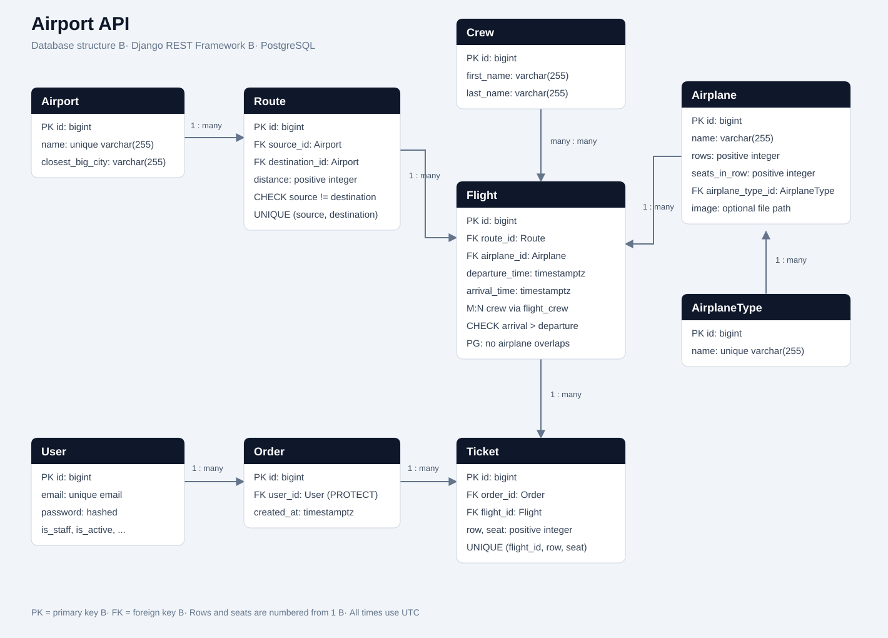
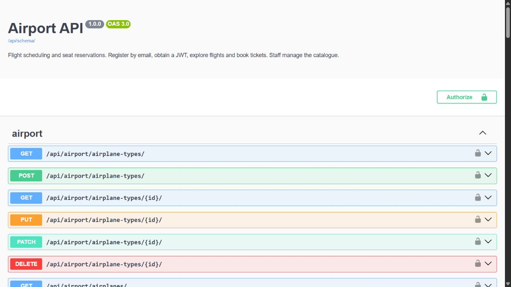
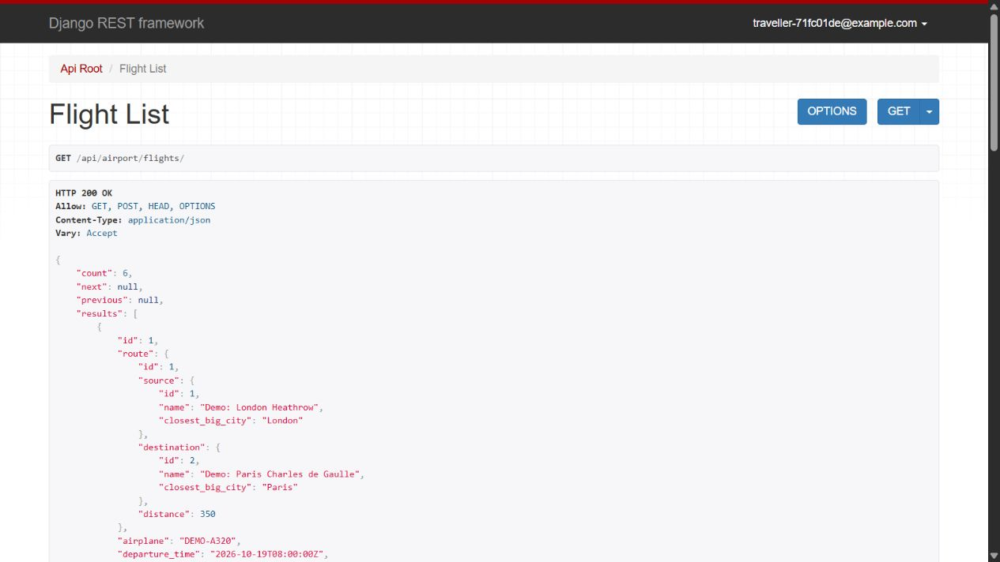
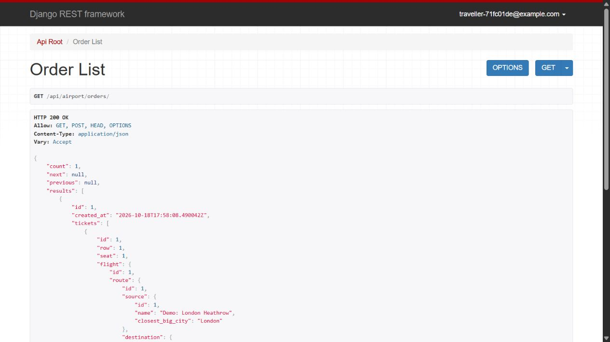

# Airport API

A Django REST Framework service for managing airports, routes, aircraft,
crews, flight schedules and seat reservations. Built as a portfolio project
using the completed [Cinema API](https://github.com/makar111111/py-dockerize-cinema)
as a learning reference. The airport domain and booking rules are implemented
as a separate application.

## Quick start

Start Docker Desktop (or Docker Engine with Compose), then:

```sh
git clone --branch develop https://github.com/makar111111/airport-api.git
cd airport-api
cp .env.example .env
```

In PowerShell, use `Copy-Item .env.example .env` for the copy step.
Set your own `DJANGO_SECRET_KEY` and `POSTGRES_PASSWORD` in `.env`, then run:

```sh
docker compose up --build -d --wait
```

Open [Swagger UI](http://127.0.0.1:8001/api/doc/swagger/).
Sample data and a staff account are optional; see [Run with Docker](#run-with-docker)
for those commands and [Authentication and booking walkthrough](#authentication-and-booking-walkthrough)
to start using protected endpoints.

## Features

- Email registration and login with JWT access/refresh tokens.
- Session login for the browsable API and an email-based Django admin.
- Staff manage airports, routes, airplane types, airplanes, crews and flights.
- Airport names and directed route pairs are unique in the database. Airport
  and crew names are trimmed and cannot consist only of whitespace.
- Authenticated passengers search flights and view available/taken seats.
- Personal orders with multiple tickets; users only see their own orders.
- Atomic reservations: either every requested ticket is booked or none is.
- Orders accept 1–100 tickets, controlled by `MAX_TICKETS_PER_ORDER`.
- Database uniqueness and PostgreSQL row locks protect seats from double booking.
- Seat bounds and departure times are checked when booking.
- PostgreSQL excludes overlapping flight times for the same airplane even for
  direct database writes. Crew scheduling uses shared resource locks and
  schedule validation in the API and admin.
- Booked flight routes, aircraft and times, and aircraft types and seating
  layouts are protected. Users with bookings can be deactivated; their
  accounts cannot be deleted while orders reference them.
- Staff-only airplane image uploads, validated as images, up to 5 MiB.
- OpenAPI schema, Swagger UI, ReDoc, pagination and request throttling.
- Docker Compose with PostgreSQL, persistent media/static/database volumes,
  non-root application user and bounded database readiness checks.
- Automated tests and GitHub Actions checks using PostgreSQL.

## Database structure



The [editable draw.io source](docs/database-diagram.drawio) can be opened at
[diagrams.net](https://app.diagrams.net/). `Flight.crew` is a many-to-many
relationship with a join table managed by Django. All datetimes are timezone
aware and stored in UTC. PostgreSQL migrations install `btree_gist` for the
airplane overlap exclusion constraint; the database role needs permission to
install this trusted extension.

## Run with Docker

Install and start Docker Desktop (or Docker Engine with the Compose plugin).
No local Python or PostgreSQL installation is needed.

```sh
git clone --branch develop https://github.com/makar111111/airport-api.git
cd airport-api
```

Copy the configuration in PowerShell:

```powershell
Copy-Item .env.example .env
```

On Linux/macOS:

```sh
cp .env.example .env
```

Set your own `DJANGO_SECRET_KEY` and `POSTGRES_PASSWORD` in `.env`.
If Python is available, generate each value with:

```sh
python -c "import secrets; print(secrets.token_urlsafe(48))"
```

Keep `.env` private.
The example values are placeholders, not deployment credentials.

```sh
docker compose up --build -d --wait
docker compose ps
docker compose exec app python manage.py seed_demo
docker compose exec app python manage.py createsuperuser
```

The application waits for PostgreSQL, runs migrations and collects static files
at startup. By default it listens on port **8001**, leaving an existing Cinema
API on port 8000 available. `--wait` waits for the application health check before
the next command runs. Change `APP_PORT` in `.env` if needed. PostgreSQL is
the default database in both the application and example environment; Compose
always selects PostgreSQL. Both services restart unless explicitly stopped,
have health checks, and are limited to one CPU and 512 MiB of memory each.

| Page | URL |
| --- | --- |
| Browsable API | <http://127.0.0.1:8001/api/airport/> |
| Swagger UI | <http://127.0.0.1:8001/api/doc/swagger/> |
| ReDoc | <http://127.0.0.1:8001/api/doc/redoc/> |
| OpenAPI schema | <http://127.0.0.1:8001/api/schema/> |
| Admin | <http://127.0.0.1:8001/admin/> |
| Browser login | <http://127.0.0.1:8001/api-auth/login/> |

`seed_demo` creates example airports, airplanes, crew and future flights. It
does not create accounts or passwords. Running it twice on the same date
does not duplicate the sample flights. For browser login, use your email in
the field labelled **Email**.

```sh
docker compose logs -f app
docker compose down
docker compose up -d
```

Named volumes preserve data when containers restart. Use `docker compose down -v`
only when you intend to remove this project's database, static and media data.

## Run locally with Python

Python **3.10** is used in Docker and CI. For local PostgreSQL, create a database
and user, set the connection details in `.env`, and use
`POSTGRES_HOST=127.0.0.1`. The Docker service name `db` is only resolvable inside
the Compose network.

For a lightweight local demonstration, explicitly set both `DB_ENGINE=sqlite`
and `DJANGO_DEBUG=True` before running these commands:

```powershell
py -3.10 -m venv .venv
.\.venv\Scripts\Activate.ps1
python -m pip install -r requirements.txt
python manage.py migrate
python manage.py seed_demo
python manage.py createsuperuser
python manage.py runserver 8001
```

On Linux/macOS, use `python3.10 -m venv .venv` and `source .venv/bin/activate`,
then run the same Python commands. The application loads `.env` automatically.
SQLite is limited to explicit debug development. Starting it with
`DJANGO_DEBUG=False` fails with a configuration error, and unknown `DB_ENGINE`
values also fail. Concurrent booking and PostgreSQL-specific database
constraints must be verified on PostgreSQL.

### Updating an existing installation

Rebuild and restart with `docker compose up --build -d --wait`; startup applies
the new migrations. Before adding catalogue constraints, the migration checks
for duplicate airport names, duplicate routes and whitespace names. If it
finds conflicts, it stops and lists the records requiring review. Resolve those
records explicitly and rerun migrations; no bookings are deleted or relinked
automatically. Existing overlapping airplane schedules must also be corrected
before PostgreSQL can install the overlap constraint.

## Authentication and booking walkthrough

The following examples use a POSIX shell. In PowerShell, invoke `curl.exe`
and write commands on one line, or use `Invoke-RestMethod`.

1. Register an account:

```sh
curl -X POST http://127.0.0.1:8001/api/user/register/ \
  -H 'Content-Type: application/json' \
  -d '{"email":"traveller@example.com","password":"Choose-a-strong-password!42"}'
```

2. Obtain access and refresh tokens:

```sh
curl -X POST http://127.0.0.1:8001/api/user/token/ \
  -H 'Content-Type: application/json' \
  -d '{"email":"traveller@example.com","password":"Choose-a-strong-password!42"}'
```

Copy `access` into `ACCESS_TOKEN` or use Swagger's **Authorize** dialog.
Send the token as `Authorization: Bearer <access>` in API requests.

3. Find a flight and inspect its occupied seats:

```sh
curl http://127.0.0.1:8001/api/airport/flights/ \
  -H "Authorization: Bearer $ACCESS_TOKEN"
curl http://127.0.0.1:8001/api/airport/flights/1/ \
  -H "Authorization: Bearer $ACCESS_TOKEN"
```

Use the actual `id` from the list: database IDs are not guaranteed to start at 1.

4. Reserve seats using that flight ID:

```sh
curl -X POST http://127.0.0.1:8001/api/airport/orders/ \
  -H "Authorization: Bearer $ACCESS_TOKEN" \
  -H 'Content-Type: application/json' \
  -d '{"tickets":[{"flight":1,"row":1,"seat":1},{"flight":1,"row":1,"seat":2}]}'
```

Rows and seats start at **1**. An occupied/out-of-range seat, duplicate seat in
the same request, or departed flight gives **400**. A failed reservation does
not leave a partial order. Authentication failures give **401**; passengers
attempting staff actions receive **403**. Unavailable objects and other users'
orders return **404**.

An order contains **1 to 100 tickets**, for passengers and staff alike. The
project setting `MAX_TICKETS_PER_ORDER` defines this maximum and the OpenAPI
schema displays it. Different seats on one flight and tickets for several
flights are supported. A repeated `(flight, row, seat)` is rejected before
reservation locks are acquired; availability is checked again while locked.
Unexpected database failures are logged and propagate as server errors rather
than being reported as occupied seats.

5. View your orders and renew an expired access token:

```sh
curl http://127.0.0.1:8001/api/airport/orders/ \
  -H "Authorization: Bearer $ACCESS_TOKEN"
curl -X POST http://127.0.0.1:8001/api/user/token/refresh/ \
  -H 'Content-Type: application/json' \
  -d '{"refresh":"YOUR_REFRESH_TOKEN"}'
```

Access tokens last 15 minutes and refresh tokens last one day. The API also
provides `POST /api/user/token/verify/` and `GET/PATCH /api/user/me/`.

## Endpoints and permissions

All endpoints below are under `/api/airport/` and require authentication.
List responses use `count`, `next`, `previous` and `results` (20 items per page).

| Resource | Passenger | Staff |
| --- | --- | --- |
| `airports/` | List, detail | Create, update, delete |
| `routes/` | List, detail | Create, update, delete |
| `airplane-types/` | List, detail | Create, update, delete |
| `airplanes/` | List, detail | Create, update, delete, upload image |
| `crew/` | List, detail | Create, update, delete |
| `flights/` | List, detail | Create, update, delete |
| `orders/` | Create, list/detail of own orders | Same ownership rules |

Protected foreign keys prevent deleting airports, routes, airplanes and airplane
types that are still referenced, and flights with tickets. Staff can replace
crew assignments; deleting a crew member removes their flight assignments.
Orders and tickets are read-only after creation, including in the admin;
payment, refunds and cancellations are outside this project's scope.

### Filtering

| Endpoint | Query parameters | Example |
| --- | --- | --- |
| `airports/` | `name`, `city` | `?city=London` |
| `routes/` | `source`, `destination` (airport IDs) | `?source=1&destination=2` |
| `airplanes/` | `airplane_type` (ID) | `?airplane_type=1` |
| `flights/` | `source`, `destination`, `date`, `available`, `ordering` | `?date=2026-11-01&available=true` |

`date` is a departure date in **UTC**, formatted `YYYY-MM-DD`. Invalid filter
values return **400** with a field error. Flight lists include available seat
counts; detail responses include nested route, airplane, crew and taken seats.
Use `ordering=departure_time` (default) or `ordering=-departure_time`. Equal
departure times are ordered by ascending ID. `available=true` selects flights
with at least one free seat; `available=false` selects full flights. Omitting
`available` returns both. Unknown airport IDs return an empty list.

Filters accept one value per supported parameter. Repeating a supported filter,
even with the same value, returns **400** instead of silently choosing a value.
Unknown query parameters are ignored by the filter validator; pagination
parameters are handled separately by pagination.

### Staff image upload

```sh
curl -X POST http://127.0.0.1:8001/api/airport/airplanes/1/upload-image/ \
  -H "Authorization: Bearer $STAFF_ACCESS_TOKEN" \
  -F 'image=@airplane.jpg'
```

This endpoint accepts a real image in multipart form. A shared model validator
checks content and the **5 MiB** limit for API, admin and model writes, including
direct file saves. The stored name is a UUID plus an extension detected by
Pillow from the actual image content; a PNG named `.jpg` is stored as `.png`.
The response includes the image URL. Normal JSON airplane updates do not accept
uploaded files.

## Verification

Run the full suite against Docker's PostgreSQL and check migrations/schema/style:

```sh
docker compose run --rm app python manage.py test --settings=config.test_settings --noinput
docker compose run --rm app python manage.py makemigrations --check --dry-run
docker compose run --rm app python manage.py spectacular --validate --fail-on-warn
docker compose run --rm app flake8
```

| Command | Expected result |
| --- | --- |
| `test --settings=config.test_settings --noinput` | All tests finish with `OK`; PostgreSQL runs the concurrency and exclusion-constraint checks. Django creates and removes a separate test database. |
| `makemigrations --check --dry-run` | `No changes detected`, exit code 0; the model definitions match committed migrations. This does not apply migrations. |
| `spectacular --validate --fail-on-warn` | A valid OpenAPI schema and exit code 0, with no warnings or schema errors. |
| `flake8` | No diagnostic output and exit code 0. |

For fast local SQLite tests:

```sh
python manage.py test --settings=config.test_settings --noinput
python -m flake8
```

Test settings use a fast password hasher and disable request throttling so tests
remain independent; runtime settings use Django's normal password hashing and
rate limits (30 anonymous / 120 authenticated requests per minute). CI executes
the tests against PostgreSQL, checks code style, migration consistency and
OpenAPI validity. Throttling uses Django's local-memory cache for this single
development process; multiple production workers need a shared cache.

See [Testing](docs/testing.md) for coverage and verification commands, and
[Architecture](docs/architecture.md) for application boundaries and data integrity.

## API screenshots





## Project layout

```text
airport/       Models, catalogue API, reservations, management commands, tests
user/          Email accounts, JWT, account API, admin forms and tests
config/        Django settings, URL routing and entry points
docs/          Architecture, testing guide, OpenAPI schema, diagram and screenshots
```

The Docker configuration runs Django's development server and serves media for
local demonstrations. A production deployment needs a production application
server, `DEBUG=False`, HTTPS, reviewed hosts/secrets, and proper static/media
hosting. This project does not process payments or send real travel bookings.
